# 📚 Ex Libris - API REST & Plataforma de Reseñas Literarias

> **Evaluación Final Integradora (EFI) 2026**
> **Espacio Curricular:** Ingeniería de Software  
> **Carrera:** Técnico Superior en Desarrollo de Software – ITEC Río Cuarto  
> **Docente:** Facundo Esteban Lemo  

---

## 📖 Descripción del Proyecto

**Ex Libris** es una plataforma web para la gestión de catálogo bibliográfico, crítica literaria y listas de lectura. Este repositorio contiene el proyecto backend desarrollado con **Django** y **Django REST Framework (DRF)**, el cual expone una API REST para ser consumida por la aplicación frontend (desarrollada en Next.js).

### 🎯 Características Principales
* **Catálogo completo:** Gestión de autores, editoriales, géneros, países y libros.
* **Interacción social:** Publicación de reseñas estructuradas con puntuación, comentarios y sistema de "Me Gusta".
* **Listas de lectura:** Organización del estante personal de los usuarios (Por leer, Leyendo, Leído, Abandonado).
* **Seguridad & Autenticación:** Autenticación por Tokens (SimpleJWT) y sesión, con roles y permisos en los endpoints.
* **Documentación interactiva:** Swagger UI y Redoc para exploración de la API REST.

---

## 🗄️ Planificación de la Base de Datos (DER)

La arquitectura de la base de datos está compuesta por **13 modelos interactivos y relacionales** organizados en 3 aplicaciones modulares (`users`, `catalogo` y `resenas`):

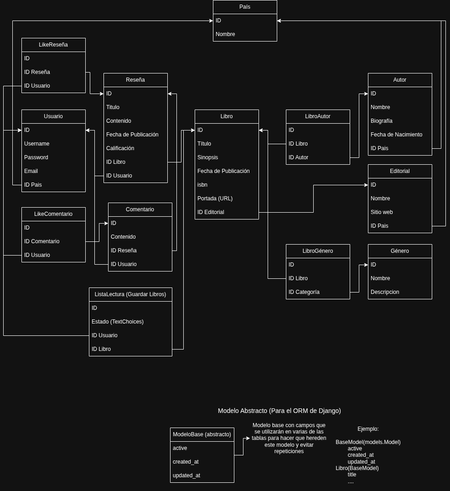

### 1. Modelos por Aplicación

* **Core (`core`):**
  * `BaseModel`: Clase abstracta que provee trazabilidad con `is_active` (borrado lógico), `created_at` y `updated_at`.
* **Usuarios (`users`):**
  * `CustomUser`: Modelo personalizado que hereda de `AbstractUser` e incluye campos adicionales como `pais` y `bio`.
  * `Country`: Catálogo geográfico para ubicación de usuarios, autores y editoriales.
* **Catálogo (`catalog`):**
  * `Genre`: Géneros y clasificaciones literarias.
  * `Publisher`: Casas editoriales con país de origen y sitio web.
  * `Author`: Ficha biográfica de escritores.
  * `Book`: Entidad central del catálogo con ISBN, sinopsis, portada y relaciones con autor, género y editorial.
* **Reseñas e Interacciones (`reviews`):**
  * `Review`: Críticas literarias con calificación de 1 a 5 estrellas escritas por usuarios.
  * `Comment`: Hilos de debate en cada reseña.
  * `LikeReview` & `LikeComemnt`: Registro de votos "Me Gusta" en reseñas y comentarios.
  * `ReadingList`: Estante virtual del usuario con estado restringido (`POR_LEER`, `LEYENDO`, `LEIDO`, `ABANDONADO`).

---

## 🛠️ Stack Tecnológico

* **Lenguaje:** Python 3.12
* **Framework Web:** Django 5.x + Django REST Framework
* **Gestor de Entornos & Dependencias:** `uv`
* **Base de Datos:** PostgreSQL (en contenedor Docker)
* **Autenticación:** DRF SimpleJWT (JSON Web Tokens)
* **Contenerización:** Docker & Docker Compose

---

## 🚀 Instrucciones de Ejecución Local

### Prerrequisitos
* Tienes instalado **Docker Engine** y **Docker Compose**.
* Tienes instalado el gestor de paquetes **`uv`**.

### 1. Clonar el repositorio y configurar variables de entorno
```bash
git clone [https://github.com/gblengino/ex-libris_api.git](git@github.com:gblengino/ex-libris_api.git)
cd ex-libris_api

# Crear archivo de variables de entorno a partir de la plantilla
cp .env.example .env
```

### 2. Opción A: Desarrollo Local con `uv` (Recomendado)

1. **Levantar la base de datos PostgreSQL en Docker:**
   ```bash
   docker compose up -d db
   ```

2. **Instalar dependencias y sincronizar el entorno:**
   ```bash
   uv sync
   ```

3. **Ejecutar las migraciones de Django:**
   ```bash
   uv run python src/manage.py migrate
   ```

4. **Crear un superusuario para el panel de administración:**
   ```bash
   uv run python src/manage.py createsuperuser
   ```

5. **Iniciar el servidor de desarrollo:**
   ```bash
   uv run python src/manage.py runserver
   ```
   La API estará accesible en `http://127.0.0.1:8000/`.

---

### 2. Opción B: Ejecución 100% en Docker

Para ejecutar el backend completo junto a la base de datos dentro de contenedores:
```bash
docker compose up --build
```

---

## 📌 Endpoints de la API y Documentación

Una vez iniciado el servidor, puedes acceder a la API navegable y a la documentación OpenAPI en:

* **Página de bienvenida:** `http://127.0.0.1:8000/`
* **Swagger UI:** `http://127.0.0.1:8000/api/swagger-ui/`
* **Redoc:** `http://127.0.0.1:8000/api/redoc/`
* **Panel de Administración de Django:** `http://127.0.0.1:8000/admin/`

---

## 📸 Capturas del Sistema

Esta sección presenta las principales funcionalidades implementadas en la API REST.

### 1. Página de bienvenida

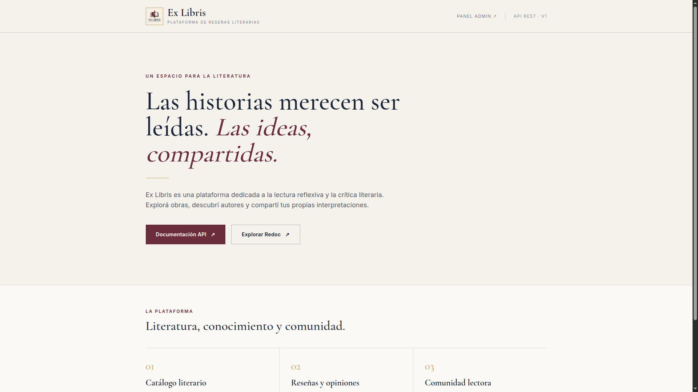

### 2. Documentación de la API

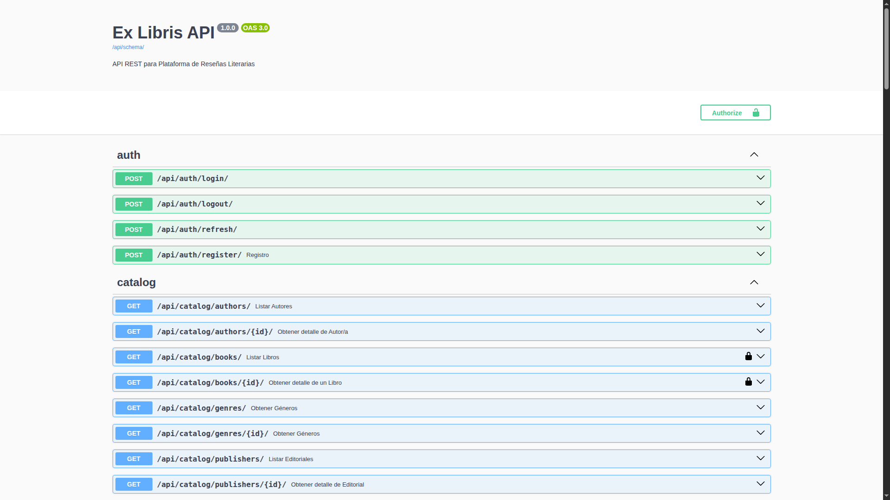

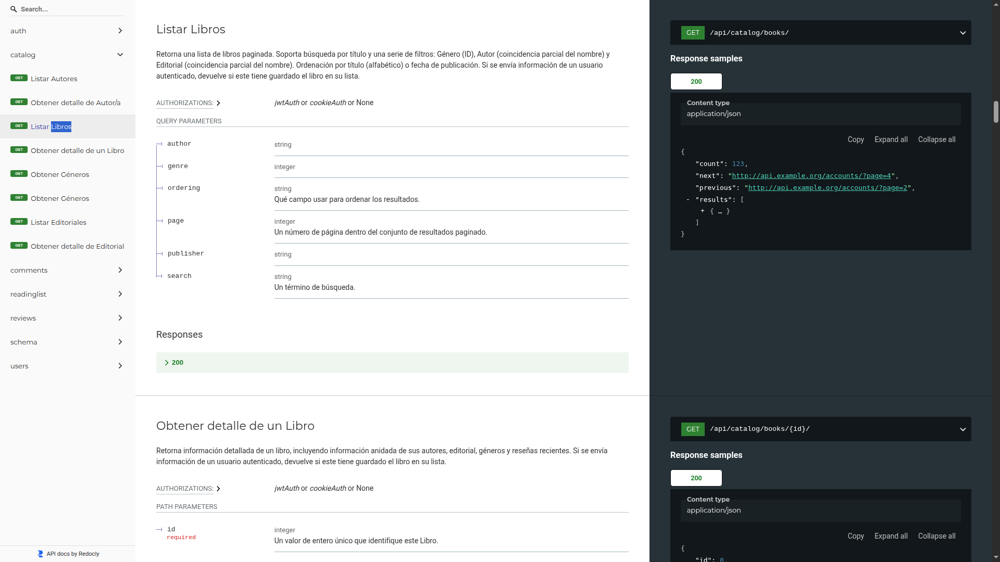
### 3. Catálogo

#### Listado de libros

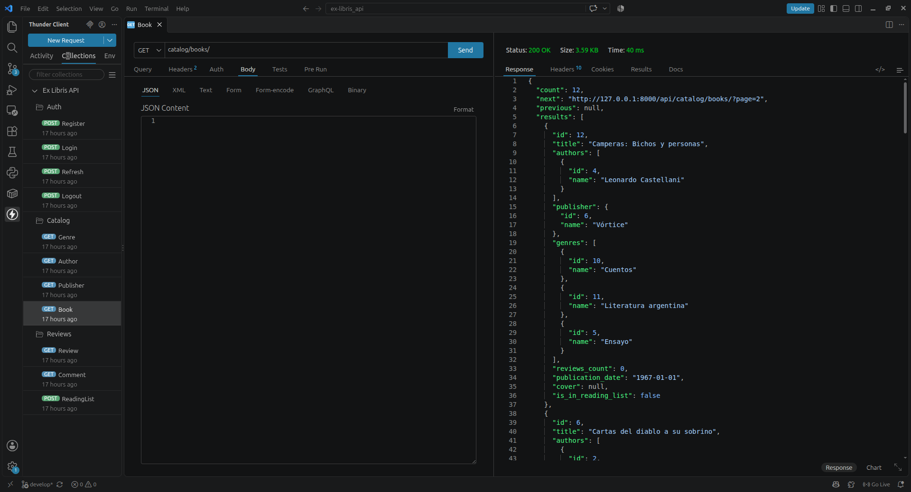

#### Filtrado de Lista de Libros

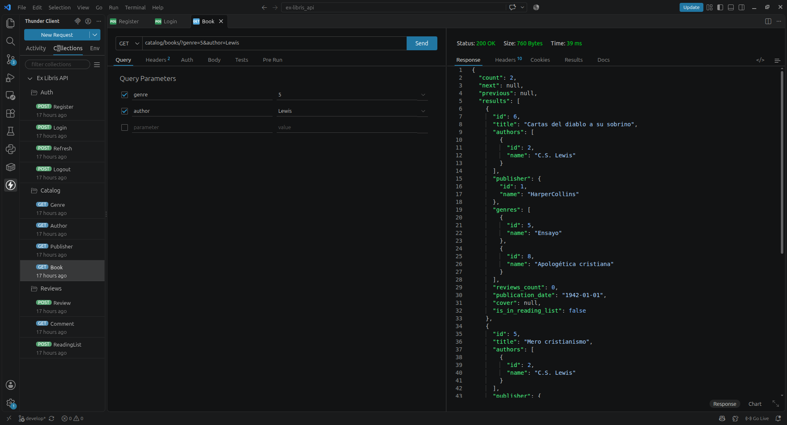

### 4. Autenticación

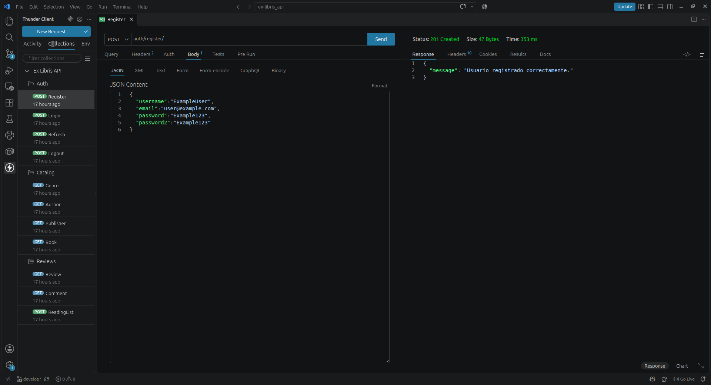

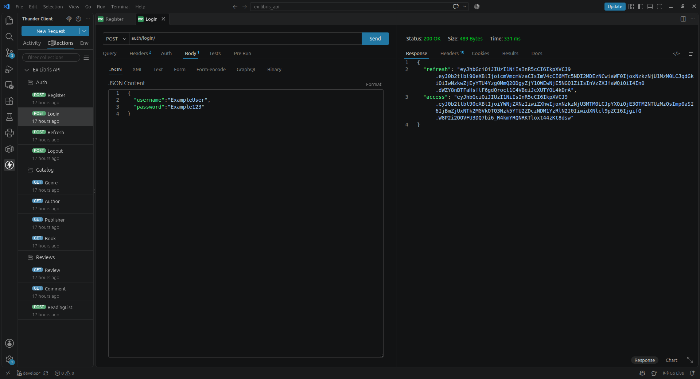

### 5. Endpoint protegido

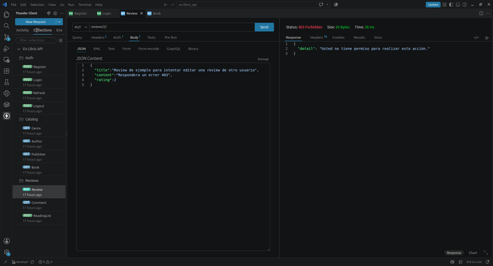

### 6. Reseñas e interacciones

#### Creación de Reseñas

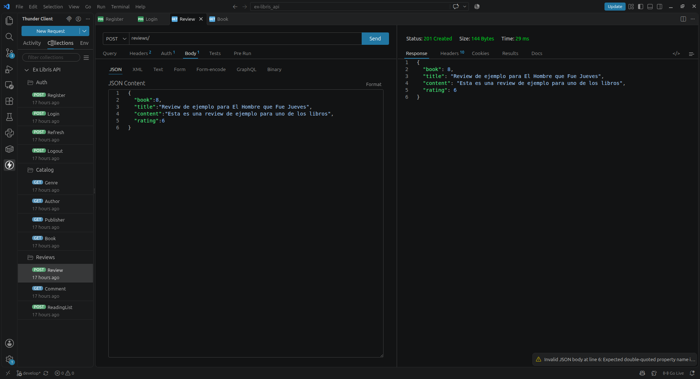

#### Acciones de interacción

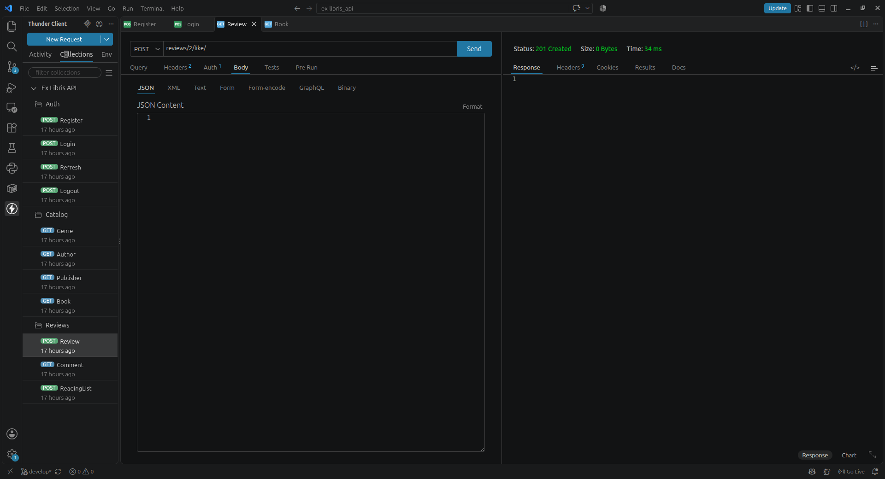

### 7. Django Admin

#### Gestión de reseñas

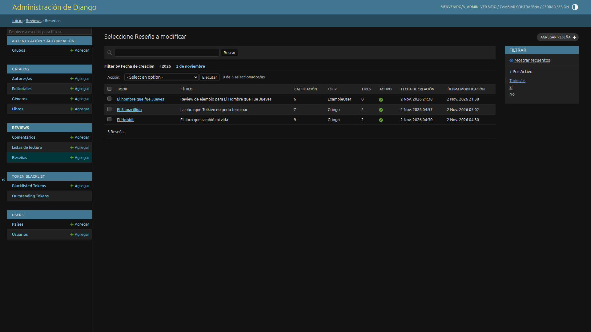

### Gestión de libros

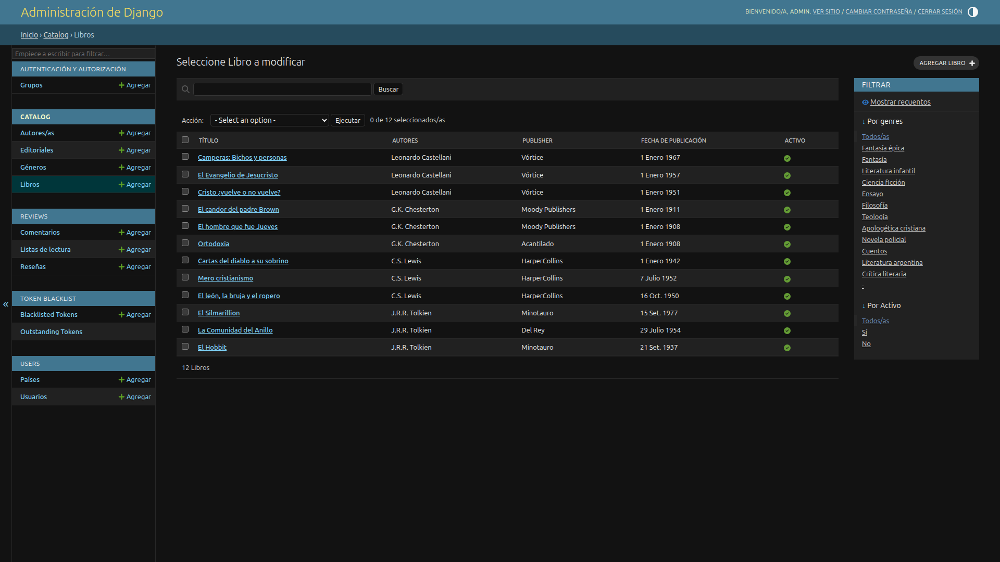

---

## 👥 Integrantes

* **Giuliano Blengino** - *Desarrollo Backend / Ingeniería de Software*