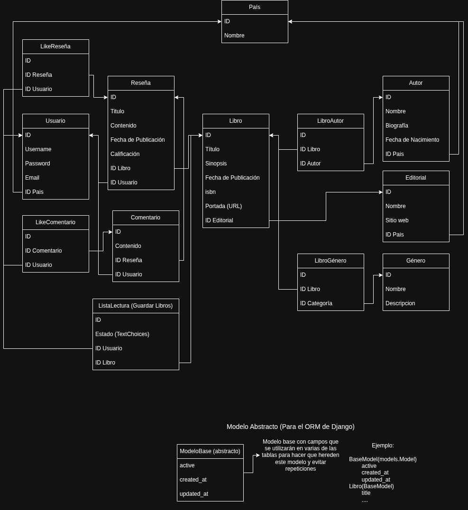

# 📚 Ex Libris - API REST & Plataforma de Reseñas Literarias

> **Evaluación Final Integradora (EFI) 2026**[cite: 1, 3]  
> **Espacio Curricular:** Ingeniería de Software  
> **Carrera:** Técnico Superior en Desarrollo de Software – ITEC Río Cuarto  
> **Docente:** Facundo Esteban Lemo  

---

## 📖 Descripción del Proyecto

**Ex Libris** es una plataforma web para la gestión de catálogo bibliográfico, crítica literaria y listas de lectura[cite: 2, 5]. Este repositorio contiene el proyecto backend desarrollado con **Django** y **Django REST Framework (DRF)**[cite: 3, 5], el cual expone una API REST para ser consumida por la aplicación frontend (desarrollada en Next.js)[cite: 1, 5].

### 🎯 Características Principales
* **Catálogo completo:** Gestión de autores, editoriales, géneros, países y libros[cite: 2].
* **Interacción social:** Publicación de reseñas estructuradas con puntuación, comentarios y sistema de "Me Gusta"[cite: 2].
* **Listas de lectura:** Organización del estante personal de los usuarios (Por leer, Leyendo, Leído, Abandonado)[cite: 2].
* **Seguridad & Autenticación:** Autenticación por Tokens (SimpleJWT) y sesión, con roles y permisos en los endpoints.
* **Documentación interactiva:** Swagger UI y Redoc para exploración de la API REST.

---

## 🗄️ Planificación de la Base de Datos (DER)

La arquitectura de la base de datos está compuesta por **13 modelos interactivos y relacionales** organizados en 3 aplicaciones modulares (`users`, `catalogo` y `resenas`)[cite: 2, 3, 4]:


*(Adjunto de planificación del Modelo Entidad-Relación de la base de datos)*[cite: 3, 6].

### 1. Modelos por Aplicación

* **Core (`apps.core`):**
  * `ModeloBase`: Clase abstracta que provee trazabilidad con `is_active` (borrado lógico), `created_at` y `updated_at`[cite: 2].
* **Usuarios (`apps.users`):**
  * `Usuario`: Modelo personalizado que hereda de `AbstractUser` e incluye campos adicionales como `pais` y `bio`[cite: 2, 4].
  * `Pais`: Catálogo geográfico para ubicación de usuarios, autores y editoriales[cite: 2].
* **Catálogo (`apps.catalogo`):**
  * `Genero`: Géneros y clasificaciones literarias[cite: 2].
  * `Editorial`: Casas editoriales con país de origen y sitio web[cite: 2].
  * `Autor`: Ficha biográfica de escritores[cite: 2].
  * `Libro`: Entidad central del catálogo con ISBN, sinopsis, portada y relaciones con autor, género y editorial[cite: 2].
  * `LibroAutor` & `LibroGenero`: Tablas intermedias explícitas con metadata relacional[cite: 2].
* **Reseñas e Interacciones (`apps.resenas`):**
  * `Resena`: Críticas literarias con calificación de 1 a 5 estrellas escritas por usuarios[cite: 2].
  * `Comentario`: Hilos de debate en cada reseña[cite: 2].
  * `LikeResena` & `LikeComentario`: Registro de votos "Me Gusta" en reseñas y comentarios[cite: 2].
  * `ListaLectura`: Estante virtual del usuario con estado restringido (`POR_LEER`, `LEYENDO`, `LEIDO`, `ABANDONADO`)[cite: 2].

---

## 🛠️ Stack Tecnológico

* **Lenguaje:** Python 3.12[cite: 3, 5]
* **Framework Web:** Django 5.x + Django REST Framework[cite: 3, 5]
* **Gestor de Entornos & Dependencias:** `uv`[cite: 3]
* **Base de Datos:** PostgreSQL (en contenedor Docker)[cite: 3]
* **Autenticación:** DRF SimpleJWT (JSON Web Tokens)[cite: 3]
* **Contenerización:** Docker & Docker Compose[cite: 3]

---

## 🚀 Instrucciones de Ejecución Local

### Prerrequisitos
* Tienes instalado **Docker** y **Docker Desktop**.
* Tienes instalado el gestor de paquetes **`uv`**.

### 1. Clonar el repositorio y configurar variables de entorno
```bash
git clone [https://github.com/tu-usuario/ex-libris-back.git](https://github.com/tu-usuario/ex-libris-back.git)
cd ex-libris-back

# Crear archivo de variables de entorno a partir de la plantilla
cp .env.example .env
```

### 2. Opción A: Desarrollo Local con `uv` (Recomendado)

1. **Levantar la base de datos PostgreSQL en Docker:**
   ```bash
   docker compose up -d db
   ```

2. **Instalar dependencias y sincronizar el entorno:**
   ```bash
   uv sync
   ```

3. **Ejecutar las migraciones de Django:**
   ```bash
   uv run python src/manage.py migrate
   ```

4. **Crear un superusuario para el panel de administración:**
   ```bash
   uv run python src/manage.py createsuperuser
   ```

5. **Iniciar el servidor de desarrollo:**
   ```bash
   uv run python src/manage.py runserver
   ```
   La API estará accesible en `http://127.0.0.1:8000/`.

---

### 3. Opción B: Ejecución 100% en Docker

Para ejecutar el backend completo junto a la base de datos dentro de contenedores:
```bash
docker compose up --build
```

---

## 📌 Endpoints de la API y Documentación

Una vez iniciado el servidor, puedes acceder a la API navegable y a la documentación OpenAPI en:

* **Swagger UI:** `http://127.0.0.1:8000/api/docs/`[cite: 4]
* **Redoc:** `http://127.0.0.1:8000/api/redoc/`[cite: 4]
* **Panel de Administración de Django:** `http://127.0.0.1:8000/admin/`[cite: 4]

---

## 📸 Capturas del Sistema

*(Se añadirán imágenes de la API navegable, Swagger UI y el Panel de Administración durante la integración final)*[cite: 4].

---

## 👥 Integrantes

* **Giuliano Blengino** - *Desarrollo Backend / Ingeniería de Software*[cite: 4]